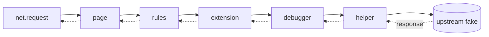

# Tweak Bundle Architecture Plan (`0.40.0-alpha`)

**Status:** implemented in 0.40.0-alpha (every phase of §9). Kept as the design record.

All code in this document is a proposed interface, not something that exists yet, unless a section says "today".

---

## 1. Summary

In `0.40.0-alpha`, a tweak becomes a normal TypeScript project:

- **A tweak is a folder with a `package.json`.** The smallest tweak is `package.json` + `index.ts`.
- **One tweak per folder, reached with `import { tweak } from "tangitweak"`.** `tweak` owns the params, stores and handlers. The `tt` global goes away, with no compatibility layer.
- **The SDK is on npm** as `tangitweak` (with `tangitweak/test`), so `tsc --noEmit`, editor autocomplete, linters and Vitest work without TangiTweak-specific setup.
- **Authors never run a build.** TangiTweak builds each bundle itself with today's pipeline.
- **Tests read like Playwright or React Testing Library tests.** Each test and each tab gets its own copy of the tweak, and tests follow each strategy's real limits.

---

## 2. Decisions

### 2.1 Decided

| Decision | Section |
| :--- | :--- |
| A tweak is a folder whose `package.json` has a `"tangitweak"` block. It replaces `metadata.json`. Name, description, icon, version and `connect` hosts live only in `package.json`. | §4, §7.1 |
| One tweak per bundle, implicit: every file imports the same `tweak` from `"tangitweak"`. No `createTweak`, no `tweak.ts`, no tweak ID. Two tweaks are two bundles. | §4.1 |
| One npm package, `tangitweak`, with a `tangitweak/test` entry. | §8 |
| Live stores: tweak code reads and writes stores directly (`palette.open = true`, `useSnapshot(palette)`). | §5.1 |
| `globalStore` takes an ID. The ID, not the file or variable name, is the key of its saved data. | §5.2 |
| Tests keep stores apart by running a fresh copy of the bundle for each test and each tab ("Copy"). | §5.3 |
| No bundler. Today's pipeline builds bundles. Polyfills are imports placed first. | §7.1, §7.3 |
| No backward compatibility. `tt.*`, single-file scripts and `metadata.json` bundles stop working. Built-in samples and `bonsai` are rewritten. | §7.5 |
| Release as `0.40.0-alpha` once implemented. | §9, Phase 4 |

### 2.2 Needs your decision

| # | Question | Options | Recommended |
| :-- | :--- | :--- | :--- |
| 1 | Test styles (§6.1–§6.4) | Approve the three styles with these defaults: assert on the UI first, `tweak.store(...)` as a rare escape hatch, Playwright names (`goto`, `press`, `click`). | Approve. |
| 2 | Do tests follow each strategy's real limits? (§6.6) | On by default, or opt-in. | **On by default.** `0.40.0-alpha` already breaks the test API. |
| 3 | npm packages written for Node (§7.4) | Add the resolver fallback and `npm:` alias support, or leave such packages unsupported. | **Add both.** Each is a small change. |
| 4 | Version check (§8.2) | Full semver range, or minimum version only. | **Minimum only.** A full range breaks every tweak on each minor release. |
| 5 | Testing one component (§6.3) | Plain React Testing Library only, `mount` only, or both. | **Both.** Plain for quick checks, `mount` when a test needs its own stores or `test.concurrent`. |
| 6 | Boilerplate cuts (§4.5) | Approve each row: no `fixtures.ts`, no `vitest.config.ts`, shorter `package.json` and `tsconfig.json`. | **Approve all four.** The examples in this plan assume them. |
| 7 | Names for `tabStore`, `pageStore`, `siteStore` (§5.2) | Drop the name (the store is found by its file and position), or keep it required as for `globalStore`. | **Drop it.** These stores are never saved, so a rename can't lose data. |
| 8 | Browser gaps in tests (§6.7) | Close the five closable gaps in `0.40.0-alpha`, or leave them to the real-browser suite. | **Close them.** They reuse the extension's checks plus `re2js`. |
| 9 | Per-bundle data folder (§5.6) | Default name (`.tweak`, `.data`, `tweak-data`), and whether **New Tweak…** git-ignores it. | **`.tweak`, git-ignored.** Short, hidden like `.vscode`, and param values can hold tokens. |

**Action for you (not a design choice):** the one-time `npm publish` that creates the `tangitweak` package, then linking the repository as a Trusted Publisher (§8.4).

---

## 3. Vocabulary

| Term | Replaces | Meaning |
| :--- | :--- | :--- |
| **Tweak Bundle** | *Bundle* (`metadata.json`) and standalone `.ts` / `.tsx` scripts | A folder with a `package.json` that has a `"tangitweak"` block. The only way to ship a tweak. |
| **Tweak** | *Script* | What a bundle runs: one enable switch, its params, stores and handlers. Its code reaches it as `tweak` from `"tangitweak"`. One per bundle. |

---

## 4. Authoring

### 4.1 SDK surface (`"tangitweak"`)

```ts
import { tweak } from "tangitweak";
```

Every file in the bundle imports the same `tweak`. Each loaded copy of the bundle (each tab, each world, each test) gets its own. Name, description, icon, version and `connect` hosts come from `package.json`.

| Category | Methods on `tweak` |
| :--- | :--- |
| **Params** | `tweak.params(defs)` |
| **Stores** | `tweak.globalStore(id, initial, options?)` · `tweak.tabStore(initial)` · `tweak.pageStore(initial)` · `tweak.siteStore(initial)` |
| **Network handlers** | `tweak.onRequest(route, fn)` · `tweak.onResponseHeaders(route, fn)` · `tweak.replaceResponse(route, fn)` · `tweak.onResponseBody(route, fn)` |
| **Page handlers** | `tweak.onSite(route, fn)` · `tweak.onPage(route, fn)` · `tweak.onOverlay(route, fn)` |
| **Utilities** | `tweak.fetch(url, init?)` · `tweak.storage` (`get` / `set` / `remove`) · `tweak.log(...args)` |

### 4.2 Smallest bundle

**New Tweak…** creates three files, plus a `.gitignore` for the data folder (§5.6):

```text
github-compact/
├── package.json
├── tsconfig.json
└── index.ts
```

```json
{
  "name": "github-compact",
  "version": "1.0.0",
  "description": "Slimmer navigation bar and optional telemetry block on github.com",
  "tangitweak": { "displayName": "GitHub Compact Header" },
  "dependencies": { "tangitweak": "^0.40.0-alpha" }
}
```

```json
{ "extends": "tangitweak/tsconfig.json" }
```

```ts
// index.ts
import { tweak } from "tangitweak";

const cfg = tweak.params({
    blockTelemetry: { type: "boolean", default: true, description: "Block browser telemetry pings" },
    headerHeight: { type: "number", default: 44, min: 32, max: 64 },
});

if (cfg.blockTelemetry) {
    tweak.onRequest(
        { url: "https://collector.github.com/*", strategy: "rules" },
        () => ({ block: true }),
    );
}

tweak.onPage("*://github.com/*", (ctx) => {
    ctx.style("compact-header", `header.AppHeader { min-height: ${cfg.headerHeight}px !important; }`);
});
```

### 4.3 A bundle with many files

```text
atlas-devtools/
├── package.json
├── tsconfig.json
├── index.tsx                    # entry
├── polyfills.ts                 # optional (§7.3)
├── features/
│   ├── misc-tweaks/
│   │   ├── rules.ts             # plain functions
│   │   ├── state.ts             # stores
│   │   ├── TweaksPalette.tsx    # React + an npm package (`cmdk`)
│   │   └── index.tsx            # export function installMiscTweaks(...)
│   └── backend-override/
│       └── index.tsx
└── __tests__/
    ├── rules.test.ts
    ├── TweaksPalette.test.tsx
    └── misc-tweaks.test.tsx
```

**`package.json`:**

```json
{
  "name": "atlas-devtools",
  "version": "1.4.0",
  "description": "Developer palette, flag overrides, and request tools for MongoDB Atlas",
  "scripts": { "test": "vitest run", "typecheck": "tsc --noEmit" },
  "tangitweak": {
    "displayName": "Atlas DevTools",
    "icon": "./icon.svg",
    "connect": ["cloud.mongodb.com"],
    "updateURL": "https://github.com/acme/atlas-devtools/tree/main"
  },
  "dependencies": {
    "tangitweak": "^0.40.0-alpha",
    "cmdk": "^1.0.4",
    "react": "^19.0.0",
    "valtio": "^2.1.0"
  },
  "devDependencies": {
    "@testing-library/react": "^16.3.0",
    "@types/react": "^19.0.0",
    "happy-dom": "^21.0.0",
    "typescript": "^5.7.0",
    "vitest": "^2.1.0"
  }
}
```

**`features/misc-tweaks/state.ts`:**

```ts
import { tweak } from "tangitweak";

export const choices = tweak.globalStore("misc-tweaks", { tweaks: {} as Record<string, boolean> });
export const palette = tweak.tabStore({ open: false });
export const site = tweak.siteStore({ lastUrl: "" });
```

**`features/misc-tweaks/TweaksPalette.tsx`** (live stores, §5):

```tsx
import { Command } from "cmdk";
import { useSnapshot } from "valtio";
import { choices, palette } from "./state";

export function TweaksPalette() {
    const { open } = useSnapshot(palette);
    const { tweaks } = useSnapshot(choices);
    if (!open) return null;

    return (
        <Command label="Misc Tweaks">
            <Command.Item onSelect={() => { choices.tweaks.compactNav = !tweaks.compactNav; }}>
                Compact Navigation: {tweaks.compactNav ? "ON" : "OFF"}
            </Command.Item>
        </Command>
    );
}
```

**`features/misc-tweaks/index.tsx`** (a plain exported function):

```tsx
import { tweak } from "tangitweak";
import { palette, site } from "./state";
import { TweaksPalette } from "./TweaksPalette";

export function installMiscTweaks(cfg: { url: string | string[]; shortcut: string }) {
    tweak.onSite(cfg.url, () => {
        site.lastUrl = location.href;
    });

    tweak.onPage(cfg.url, (ctx) => {
        ctx.shortcut(cfg.shortcut, () => { palette.open = !palette.open; });
        ctx.mount(<TweaksPalette />);
    });
}
```

**`index.tsx`:**

```tsx
import "./polyfills";               // only if needed; always first (§7.3)
import { tweak } from "tangitweak";
import { installMiscTweaks } from "./features/misc-tweaks";
import { installBackendOverride } from "./features/backend-override";

const cfg = tweak.params({
    urls: { type: "stringList", default: ["*://cloud.mongodb.com/*"] },
    paletteShortcut: { type: "shortcut", default: "Mod+Shift+M" },
});

installMiscTweaks({ url: cfg.urls, shortcut: cfg.paletteShortcut });
installBackendOverride({ url: cfg.urls });
```

### 4.4 Registration rules

The same bundle is loaded in several places: the background, the page's isolated world, the site's MAIN world, and the overlay. These rules keep them in agreement.

1. **Register while the entry file loads.** `params`, stores and handlers are all called at load time, not inside a handler, a timer or after an `await`.
2. **Register the same things in the same order everywhere.** A handler is identified by its position ("the 2nd `onPage`"), and so are tab, page and site stores (§5.2). Registration may depend on params (`if (cfg.blockTelemetry) …`) but not on the DOM, store contents or the time.
3. **A param change reloads the bundle** with the new values, as today.
4. **A failed reload keeps the previous working version.** The old version's listeners, mounts and timers are stopped only when the new one has registered without error.
5. **Saved values live in the bundle's data folder** (§5.6): params in one file, each `globalStore` in a file named by its ID. Renaming the folder, a file, a variable, the npm `name` or the display name doesn't lose them.

**Why rule 2 matters:** today the compiler rewrites `tt.onPage(` in the source into a numbered form (`.k(n)`, `src/shared/compile.ts:832-845`). That only works for the fixed name `tt`. With `tweak` imported across files under any name, handlers are counted when they register instead. Phase 0 proves this (§9).

**Store rules that must not change** (tests have to keep them too):

| Store | Lifetime and access |
| :--- | :--- |
| `globalStore` | Shared by all tabs. Saved unless `persist: false`. Not available in `onSite`. |
| `tabStore` | Survives navigation in a tab. Removed when the tab closes. In network handlers, only before the first `await`. |
| `pageStore` | Resets on a document load, not on SPA navigation. Not available to `rules` handlers. |
| `siteStore` | Lives in the page's own JS world, mirrored with a delay, untrusted. Not available to network handlers. |

### 4.5 Boilerplate cuts (decision 6)

The examples above assume all four rows.

| | Cut | How | If not approved, a bundle also needs |
| :-- | :--- | :--- | :--- |
| a | `__tests__/fixtures.ts` | `import { test } from "tangitweak/test"` finds the bundle from the test file's folder: the nearest `package.json` with a `"tangitweak"` block. `createTweakTest({ entry, params })` is still there for another entry file or other params. | A one-line `fixtures.ts` that every test imports. |
| b | `vitest.config.ts` | Fixture and `mount` tests don't need a DOM environment: the loader makes its own documents (§5.4). A plain React Testing Library test adds `// @vitest-environment happy-dom` at its top. Depends on Phase 0, item 2. | `export default defineConfig({ test: { environment: "happy-dom" } })` |
| c | `"main"`, `"private"`, `"type"` in `package.json` | `"main"` defaults to `index.ts`, then `index.tsx`. The others aren't required. | Those three fields. |
| d | Compiler options in `tsconfig.json` | `{ "extends": "tangitweak/tsconfig.json" }` | The full option list. |

---

## 5. Stores

### 5.1 Live stores

Tweak code reads and writes a store directly, as today:

```tsx
// state.ts
export const palette = tweak.tabStore({ open: false });

// TweaksPalette.tsx
const { open } = useSnapshot(palette);          // read
palette.open = false;                           // write

// index.tsx
tweak.onPage(url, (ctx) => {
    ctx.shortcut(key, () => { palette.open = !palette.open; });
});
```

### 5.2 How a store is identified

Every world that loads the bundle must find the same store. Tests use the same identity to set and read stores (§6.2, §6.3).

| Store | Identified by | Why |
| :--- | :--- | :--- |
| `globalStore` | The ID you pass: `tweak.globalStore("misc-tweaks", initial)`. Unique within the bundle; a second store with the same ID is a load error, as today. Also its file name in the data folder (§5.6). | It is saved. Renaming the variable, file or folder keeps the data. Changing the ID starts fresh. |
| `tabStore`, `pageStore`, `siteStore` (decision 7) | The file it is created in and its position there: "the 2nd store in `features/misc-tweaks/state.ts`". | They are never saved, and every world runs the same code, so the position always matches. |

**Today** every store needs a name, and saved `globalStore` data is filed under the script's file path (`docs/editor.md:562`), so renaming a bundle folder loses it. The data folder (§5.6) fixes that.

**How the file is known:** the loader resolves `"tangitweak"` separately for each file it loads (`makeLibRequire`, `src/shared/scriptImports.ts`), so each file's `tweak` knows its own path. In a plain Vitest test, the npm package reads the calling file from the stack instead; Phase 0 checks that Vitest reports the source path there.

**Cost of dropping the name:** after an edit that moves or reorders tab, page or site stores, open tabs start those stores fresh. Tab state from an older version of the code is dropped whenever the code changes, rather than matched to the wrong store.

### 5.3 Keeping stores apart in tests: Copy

A live store is one object for each loaded copy of the code. In the browser, every tab and every world loads its own copy. The test loader does the same: fixture tests and `mount` run a fresh copy of the bundle for each test and each tab. So stores never leak between tests, two tabs in one test behave like two browser tabs, and `test.concurrent` is safe.

- **Tweak source is unchanged.** Tests run exactly the code the browser runs. Nothing is rewritten, and there is no plugin to install.
- **The browser editor and VS Code behave the same,** because `tangitweak/test` ships TangiTweak's own compiler. Both see plain TypeScript.
- **Plain component tests and plain-function tests** import code through Vitest, which loads one copy per test file (§6.5).

### 5.4 What Copy still needs

| Need | Today | Proposed |
| :--- | :--- | :--- |
| Own stores per test and per tab | Works. The harness runs the bundle once per page and world (`openPage` in `src/testing/index.ts`, through `scriptFunction` in `src/shared/scriptFn.ts`). | Keep. |
| Own document per tab | Missing. All tabs share the test file's one happy-dom `window`. | The loader hands each copy its own `window`, `document` and `location`, the same way it already hands each copy its own `console`. npm packages loaded by the loader get them too. |
| React across tabs | One React copy for the whole test file. | To be proven in Phase 0: one React copy rendering into several documents, or one React copy per tab. |
| Testing one component | Only through Vitest imports, which load one shared copy per file. | `mount` (§6.3). |
| Speed | The bundle is transpiled again for every page (no cache). Loading real npm packages in the harness is untested; its own tests only use mocked ones (`test/testingHarness.test.tsx`). | Transpile once per test file. Read npm packages from `node_modules` through the same resolver, with no network. |

### 5.5 What concurrency buys

- JavaScript runs on one thread. `test.concurrent` overlaps tests only while they wait: a page load, a `findBy…`, a slow fake server. It doesn't use more CPU cores.
- Vitest already runs test **files** in parallel, each on its own worker.
- So the main gains from Copy are: no state leaking from one test to the next, two tabs open in one test, and overlapping waits.

### 5.6 Where saved values live: the bundle's data folder (decision 9)

**Today** all scripts share two files at the root of the synced folder, keyed by the script's file path: `settings.json` (`"scripts": { "bonsai/index.tsx": { "enabled": false, "env": "staging" } }`) and `stores.json` (`{ "bonsai/index.tsx": { "<store name>": { … } } }`). Renaming a script's file loses both.

**Proposed:** each bundle keeps its own values in a data folder inside it, named `.tweak/` by default, like VS Code's `.vscode/`:

```text
atlas-devtools/
├── .gitignore                   # ".tweak/", written by New Tweak…
├── .tweak/
│   ├── settings.json            # enable switch and param values
│   └── stores/
│       ├── misc-tweaks.json     # tweak.globalStore("misc-tweaks", …)
│       └── flag-overrides.json  # tweak.globalStore("flag-overrides", …)
├── package.json
└── index.tsx
```

**`.tweak/settings.json`** holds only values that differ from the defaults, as today's root file does:

```json
{
  "enabled": true,
  "params": {
    "urls": ["*://cloud.mongodb.com/*", "*://cloud-dev.mongodb.com/*"],
    "paletteShortcut": "Mod+Shift+K"
  }
}
```

**`.tweak/stores/misc-tweaks.json`** is the saved part of that store: the whole store, or only the `persist: [...]` keys:

```json
{ "tweaks": { "compactNav": true } }
```

**Rules:**

| Topic | Rule |
| :--- | :--- |
| **Where the truth is** | Unchanged: TangiTweak's own storage. The files mirror it both ways, as `settings.json` and `stores.json` do today. Without a synced folder, the Explorer shows the same files inside each bundle. Editing and saving one updates open tabs immediately. `tweak.storage` stays in TangiTweak's storage only, with no file. |
| **Store file names** | The file is the `globalStore` ID plus `.json`. So an ID must be a valid file name: lowercase letters, digits, `-`, `_` and `.`, not starting with `.`. Lowercase only, because macOS and Windows don't tell `Flags.json` from `flags.json`. Anything else is a load error naming the store. |
| **Renames** | Renaming or moving the bundle folder, a file or a variable keeps everything, because the data moves with the folder. Changing a store's ID starts it fresh; the old file stays until deleted. Deleting a file resets that store or setting. |
| **Copies** | Two copies of one bundle in different folders have separate values. |
| **The root files** | Root `settings.json` keeps only extension-wide settings (`logLevel`, `textTypes`, the folder name below). Root `stores.json` goes away. |
| **Build** | The data folder is never part of the bundle: it can't be imported and isn't counted as source. |
| **Git** | **New Tweak…** writes a `.gitignore` with `.tweak/`. Param values can hold tokens, and saved stores are personal. To share defaults, change the param's `default` in code. |
| **Export and install** | **Export** leaves the data folder out unless **Include my settings and saved data** is ticked. Installing or updating a bundle never overwrites an existing data folder. |
| **Tests** | Tests never read the data folder. They start from the defaults plus the params the test passes, so they give the same result on every machine. |

**Folder name setting:** **Settings → Tweak data folder**, default `.tweak`. Stored in root `settings.json` as `"dataFolder"`. It must be one folder name, not `node_modules`, `__tests__` or a name starting with `.tangitweak`. Changing it renames the folder in every bundle. A bundle that already has a source folder of the new name keeps its data under the old name and shows a problem.

---

## 6. Testing (`"tangitweak/test"`)

`tangitweak/test` replaces today's `@tangitweak/test`.

### 6.1 Three styles (decision 1)

| What you test | Style | Looks like |
| :--- | :--- | :--- |
| Handlers, pages, tabs, network, params | **1. Fixtures** (§6.2) | Playwright |
| One React component | **2. Component** (§6.3): `mount`, or plain React Testing Library | Playwright or React Testing Library |
| Plain functions (parsers, helpers) | **3. Plain** (§6.4) | Ordinary Vitest |
| Real Chrome behavior: worlds, CSP, permissions | TangiTweak's own real-browser suite | Not written by tweak authors |

`loadTweak` stays as the low-level API that Style 1 is built on.

### 6.2 Style 1: fixtures

`test` from `"tangitweak/test"` is a Vitest `test` with extra fixtures (Vitest's built-in `test.extend`). Each test gets a fresh copy of the tweak and cleans up by itself.

| Fixture | What it is |
| :--- | :--- |
| `page` | A fresh tab: `goto`, `press`, `click`, `type`, `reload`. `page.ui` gives Testing Library queries for the tweak's own UI, including inside closed shadow roots. `page.document` is the website's page. |
| `browser` | `browser.newPage(url)` opens another tab in the same tweak. |
| `net` | `net.request(url, init)` sends a request through the handlers (§6.6). `net.rules` lists the generated browser rules. |
| `tweak` | Escape hatch: `setParams`, `logs`, `problems`, `store(store, page?)`. |
| `mount` | Renders one component with its own stores (§6.3). |

**UI:**

```tsx
// __tests__/misc-tweaks.test.tsx
import { expect } from "vitest";
import { test } from "tangitweak/test";

test("shortcut opens the palette", async ({ page }) => {
    await page.goto("https://cloud.mongodb.com/v2/org-1");
    expect(page.ui.queryByRole("listbox")).toBeNull();

    await page.press("Mod+Shift+M");

    await page.ui.findByRole("listbox");
});

test("compact nav choice survives a reload", async ({ page }) => {
    await page.goto("https://cloud.mongodb.com/v2/org-1");
    await page.press("Mod+Shift+M");
    await page.click(await page.ui.findByText(/Compact Navigation: OFF/));

    await page.reload();
    await page.press("Mod+Shift+M");

    await page.ui.findByText(/Compact Navigation: ON/);
});
```

**Two tabs** (needs the Phase 0 check in §9, item 2):

```tsx
test("tabs share choices but not the open palette", async ({ page, browser }) => {
    await page.goto("https://cloud.mongodb.com/v2/org-1");
    const other = await browser.newPage("https://cloud.mongodb.com/v2/org-2");

    await page.press("Mod+Shift+M");
    await page.click(await page.ui.findByText(/Compact Navigation: OFF/));

    expect(other.ui.queryByRole("listbox")).toBeNull();   // tabStore: per tab

    await other.press("Mod+Shift+M");
    await other.ui.findByText(/Compact Navigation: ON/); // globalStore: shared
});
```

**Network:**

```ts
test("adds the staging header and rewrites the flags", async ({ net }) => {
    const res = await net.request("https://cloud.mongodb.com/api/private/flags", {
        upstream: { status: 200, body: { newNav: false } },
    });

    expect(res.requestHeaders["x-atlas-env"]).toBe("staging");
    expect(res.json()).toEqual({ newNav: true });
});

test("blocks telemetry with a browser rule", async ({ net }) => {
    expect(net.rules).toContainEqual(expect.objectContaining({ action: { type: "block" } }));
});
```

**Other params:** make a second `test`, or change them in a test:

```ts
import { createTweakTest } from "tangitweak/test";

const prodTest = createTweakTest({ params: { env: "prod" } });

test("switches env", async ({ tweak, net }) => {
    await tweak.setParams({ env: "prod" });
    // ...
});
```

**State you can't see in the UI** (rare):

```ts
import { site } from "../features/misc-tweaks/state";

test("records the last visited URL", async ({ page, tweak }) => {
    await page.goto("https://cloud.mongodb.com/v2/org-1");
    expect(tweak.store(site, page).lastUrl).toBe("https://cloud.mongodb.com/v2/org-1");
});
```

**One feature only:** `createTweakTest({ entry: "./only-misc.ts" })`, where that tiny entry file imports and calls just that feature's install function.

### 6.3 Style 2: one component (decision 5)

Two ways: plain React Testing Library, shown first, and `mount`, shown after it.

```tsx
// @vitest-environment happy-dom
// __tests__/TweaksPalette.test.tsx
import { fireEvent, screen } from "@testing-library/react";
import { expect, test } from "vitest";
import { renderTweak } from "tangitweak/test";
import { TweaksPalette } from "../features/misc-tweaks/TweaksPalette";
import { choices, palette } from "../features/misc-tweaks/state";

test("shows nothing while closed", () => {
    renderTweak(<TweaksPalette />);
    expect(screen.queryByRole("listbox")).toBeNull();
});

test("toggles compact nav", async () => {
    const { store } = renderTweak(<TweaksPalette />, {
        stores: [[palette, { open: true }]],
    });

    fireEvent.click(screen.getByText(/Compact Navigation: OFF/));

    await screen.findByText(/Compact Navigation: ON/);
    expect(store(choices).tweaks.compactNav).toBe(true);
});
```

`renderTweak` is React Testing Library's `render`, plus starting values for stores and a `store(...)` reader. `vi.mock`, `vi.spyOn` and breakpoints work normally.

**Limit:** Vitest loads one copy of the component and its stores per test file. `renderTweak` resets the stores after each test, so tests in one file run one after another. React Testing Library has the same limit on its own: its `screen` and its automatic cleanup are shared by every test in the file.

**`mount`: the same test with its own stores.** `mount` loads the component through the test loader, like a page does (§5.3):

```tsx
// __tests__/TweaksPalette.test.tsx
import { expect } from "vitest";
import { test } from "tangitweak/test";
import { choices, palette } from "../features/misc-tweaks/state";

test.concurrent("toggles compact nav", async ({ mount, tweak }) => {
    const ui = await mount("features/misc-tweaks/TweaksPalette", {
        stores: [[palette, { open: true }]],
    });

    await ui.click(ui.getByText(/Compact Navigation: OFF/));

    await ui.findByText(/Compact Navigation: ON/);
    expect(tweak.store(choices).tweaks.compactNav).toBe(true);
});
```

The imported `palette` and `choices` only say **which** store is meant. `mount` and `tweak.store` find this test's own copy by the store's identity (§5.2).

| | Plain (`renderTweak`) | `mount` |
| :--- | :--- | :--- |
| The component is named by | An import. TypeScript checks it and renames follow. | A path as text. A wrong path or prop fails when the test runs, not in the editor. |
| Stores are separate per | Test file | Test |
| `test.concurrent` in one file | No | Yes |
| Replacing a dependency | `vi.mock` | The `mocks` option |
| Needs a DOM environment | Yes (`// @vitest-environment happy-dom`) | No |

### 6.4 Style 3: plain functions

```ts
import { expect, test } from "vitest";
import { parseOverrideHeader } from "../features/misc-tweaks/rules";

test("parses key=value pairs", () => {
    expect(parseOverrideHeader("env=staging, region=us-east-1")).toEqual({ env: "staging", region: "us-east-1" });
});
```

### 6.5 How each style runs the tweak

| | Style 1 (fixtures) and `mount` | Plain component tests and Style 3 |
| :--- | :--- | :--- |
| Who loads the tweak's code | TangiTweak's own compiler, as in the browser (today's `loadTweak`) | Vitest, as normal imports |
| npm packages come from | The extension's package resolver, reading `node_modules` instead of the network (§5.4) | `node_modules`, resolved by Vitest |
| Each test and tab gets its own copy of the code | Yes | No. One copy per test file. |
| Replacing a dependency | The `mocks` option (as today). `vi.mock` doesn't reach this code. | `vi.mock` |

For plain component tests and Style 3, the `tangitweak` npm package runs on its own in Node: stores are plain Valtio objects, params return their defaults, and registered handlers are recorded but never called.

### 6.6 Tests follow each strategy's real limits (decision 2)

**Today they mostly don't.** `t.simulate` runs every matching handler through one in-process chain (`runOp` in `src/shared/bodyOps.ts`). The `strategy` option only picks which handlers run. A test can pass for a handler that never runs, or runs differently, in the browser:

| Strategy | Real limit | What a test does today |
| :--- | :--- | :--- |
| *(all)* | Strategies are layers: `page → rules → extension → debugger → helper → server`. A block or replacement in a front layer hides the request from the layers behind it. | Mixes all strategies in script order and stops at the first replacement. |
| `page` | Sees only the page's own fetch/XHR. `onResponseHeaders` never runs. | Runs on any resource type and runs `onResponseHeaders`. |
| `rules` | The handler runs once at load and becomes a fixed browser rule. Only a param or store change re-runs it. | Calls the handler again on every request. |
| `extension` | Not on Chrome MV3. On Chromium MV2: no `onResponseBody`, async results ignored, replacements served by redirect. | Runs everywhere, awaits everything, keeps the URL. |
| `helper` | Chromium only. Never sees `localhost`. Does nothing while the helper isn't running. | Runs every time. |
| `debugger` | Chromium only. Can miss the first navigation in a new tab. | Runs every time. |

**Proposed: `net.request` walks the request through the same layers as the browser,** using the checks the extension already has. Handlers still run inside the test process. No browser, no helper process, no network.



1. **Pick a browser:** `createTweakTest({ browser: "chrome" })`. Options: `"chrome"` (MV3, default), `"chromium-mv2"`, `"firefox"`.
2. **At load,** handlers that can't run in that browser are turned off, with the same text the Problems view shows. `rules` handlers become fixed rules once.
3. **On the way out,** each layer sees the request only if the browser would let it. `page` sees fetch/XHR only. `helper` skips `localhost`. `rules` applies its fixed rules without calling the handler. The first block, redirect or replacement stops the request.
4. **`upstream`** (the fake server) answers only if no layer stopped the request.
5. **On the way back,** the layers in front run their response handlers, with that browser's limits. After a block nothing runs.
6. **`res.skipped`** lists every handler that didn't run and why, in the extension's own words. **`res.decidedBy`** names the handler and strategy that produced the result.

```ts
// tweak code
tweak.onRequest({ url: FLAGS, strategy: "helper" }, () => ({ replaceResponse: { body: { newNav: true } } }));
tweak.onResponseBody({ url: FLAGS, strategy: "page" }, (body) => ({ ...body, seen: true }));

// test
test("the page sees the helper's replacement", async ({ net }) => {
    const res = await net.request(FLAGS);       // a fetch/XHR by default

    expect(res.json()).toEqual({ newNav: true, seen: true });
    expect(res.decidedBy).toMatchObject({ strategy: "helper", handler: "onRequest #1" });
});

test("page handlers don't see the document", async ({ net }) => {
    const res = await net.request("https://cloud.mongodb.com/", { resourceType: "document" });

    expect(res.skipped).toContainEqual(expect.objectContaining({
        handler: "onResponseBody #1",
        why: expect.stringContaining(`the "page" strategy only sees the page's own fetch/XHR`),
    }));
});
```

Today the first test gets `{ newNav: true }`, because the harness returns at the replacement. In the browser the `page` handler does run.

A tweak for several browsers runs the same tests once per browser with `describe.each(["chrome", "firefox"])`.

**Reused from the extension, unchanged:** `runOp` (`bodyOps.ts`), `routeProblem`, `missedReason`, `isLoopbackUrl` (`missedTap.ts`), `LAYERS`, `winnerOf`, `skippedBy`, `skippedLine` (`precedence.ts`), `probeScriptRules`, `substitute` (`rulesProbe.ts`, `dnrRules.ts`). **New:** one function with the layer loop.

### 6.7 Browser gaps the loader can close (decision 8)

Everything below applies to fixture and `mount` tests, which run through the loader. Plain Vitest tests (§6.3 plain, §6.4) run in Node and close none of them.

| Gap | Close it? | How | What still differs from the browser |
| :--- | :--- | :--- | :--- |
| **Node built-ins.** Tests run in Node, so `Buffer`, `process` and `require("events")` work in tests and fail in the extension. | **Fully.** | The loader resolves imports itself, so it applies the extension's rule: a Node built-in fails unless the bundle provides it (§7.4). Each copy of the bundle gets a `globalThis` without Node's globals (`Buffer`, `process`, `global`, `setImmediate`), handed in the same way as `console` and the per-tab `window` (§5.4). | Nothing for loader tests. |
| **Rule engine: RE2.** A route's regex can be valid JavaScript but rejected by Chrome's RE2. | **Mostly.** | Check each generated rule regex with `re2js`, a pure JavaScript port of RE2 on npm. Report it with the same text as `regexProblem` (`src/background/engine/strategies/rulesStrategy.ts`). | Chrome's 2 KB regex memory limit can only be estimated. The extension already has the estimate (`regexCost`); a test fails only when it is clearly over. Close calls show a warning, not a failure. |
| **Rule engine: counts.** Chrome allows 5,000 session rules and 1,000 regex rules for the whole extension. | **Per tweak.** | Count the tweak's generated rules (`net.rules`) and fail over the limit. | Other tweaks share the same limit in the browser. A test can't know what else is installed. |
| **MAIN and isolated worlds.** They share the DOM but not JavaScript globals. | **Mostly.** | With per-tab documents (§5.4), give the `onSite` copy and the `onPage` copy of a tab the same `document` but separate `window` and `globalThis` objects. A `window.foo` or patched `fetch` in one world is then invisible to the other, as in Chrome. | Properties added to DOM nodes (`el.foo = 1`) are shared in tests but not in Chrome. Copying that would mean wrapping every DOM node. |
| **CSP.** The website's Content-Security-Policy can block what a tweak injects. | **Partly.** | `page.goto(url, { csp: "script-src 'self'" })`. The loader applies the consequences TangiTweak already handles, such as `onSite` falling back when the page forbids `eval` (`src/shared/pageShim.ts`), and reports them as problems. | happy-dom doesn't enforce CSP. Anything the tweak loads itself (an ``, a `<script>`, an inline `style` attribute) isn't blocked in tests. |
| **Debugger misses the first navigation** in a new tab. | **As a warning.** | It is a timing race, so a test can't reproduce it reliably. `res.skipped` (§6.6) lists the handler as "may miss" for a `document` request in a new tab, with the extension's own text. | A test never sees the miss itself. |
| **Browser cache.** A cached response may skip some handlers. | **No.** | Which strategies see a cached response depends on the browser and the cache headers. Copying that would be a second, guessed cache. | Stays in the real-browser suite. |
| **The helper process itself:** proxy routing, HTTPS certificates, "helper not installed". | **No.** | Tests already run `helper` handlers in-process (§6.6). The process is TangiTweak's own code, tested by TangiTweak. | Stays in the real-browser suite and `npm run test:helper`. |

**Proposed:** close the first five in Phase 3. They reuse checks the extension already has, plus one new package (`re2js`). Show the debugger warning in `res.skipped`. Leave the cache and the helper process to TangiTweak's own suites.

---

## 7. Build and packages

### 7.1 How TangiTweak builds a bundle

| Aspect | Rule |
| :--- | :--- |
| **What counts as a bundle** | A folder whose `package.json` has a `"tangitweak"` block. A `package.json` without it (such as the root one Folder Sync writes for tooling) is not a bundle. |
| **Entry** | `package.json` `"main"`, or `index.ts` / `index.tsx` when it's missing. Other files run only when imported. A loose `.ts` file outside a bundle folder isn't run. |
| **Allowed imports** | Built-ins (`"tangitweak"`, `"react"`, `"valtio"`), relative `.ts` / `.tsx` / data files, and packages listed in `"dependencies"`. |
| **Build** | Today's pipeline, inside the extension: Sucrase, the import resolver (`src/shared/compile.ts`), and the pinned package cache (`src/background/engine/packageImports.ts`). No build command, no committed `dist/`. |
| **Not synced or exported** | `*.test.*`, `*.spec.*`, `__tests__/**`, `vitest.config.*`, `node_modules/**`. The data folder (§5.6) syncs but isn't exported by default. |
| **Metadata** | `package.json`: `name`, `version`, `description`, `author`, `license`, `homepage`, and the `"tangitweak"` block. |

### 7.2 npm packages

- Packages are downloaded at exact versions into the extension's package cache. `node_modules` is never synced.
- This is not support for every npm package. Packages built for browsers work. Packages written for Node need §7.4.
- **React and Valtio always come from TangiTweak in the browser.** The versions in `package.json` only affect local type-checking and component tests. The Editor warns when the major version differs from the built-in one.

### 7.3 Polyfills: import them first

Add the polyfill to `"dependencies"` and import it at the top of the entry file. Imports run in order, so it runs before the rest of the code. Tests get the same polyfills, because they follow the same imports.

```ts
// polyfills.ts
import "core-js/actual/array/to-sorted";
import "core-js/actual/set/union";
```

```ts
// index.ts
import "./polyfills";               // always first
import { tweak } from "tangitweak";
```

**A polyfill that patches globals patches them for everyone in that world:**

| Where the code runs | Shared with | Risk of patching `Array.prototype` |
| :--- | :--- | :--- |
| `onSite` (MAIN world) | The website | Changes the site |
| Network handlers on `helper`, `extension`, `debugger`, `rules` | TangiTweak's background page (MV2) or sandbox page (MV3), and every other tweak's network handlers | Changes TangiTweak and other tweaks |
| `onPage`, overlay | Only this tweak | Low |

- Prefer versions that don't patch globals. `core-js-pure` exports functions instead:
  ```ts
  import toSorted from "core-js-pure/actual/array/to-sorted";
  toSorted(items, byName);
  ```
- Import only what you need (one `core-js/actual/...` path, not all of `core-js`).
- The Editor warns when a bundle with `onSite` or network handlers imports a known global-patching package.

### 7.4 npm packages written for Node (decision 3)

They break in two ways. Import-first fixes only the first:

| Problem inside the package | Fails when | Fixed by import-first? |
| :--- | :--- | :--- |
| Uses the `Buffer` / `process` globals | The line runs | **Yes.** Set the global in `polyfills.ts`. |
| `require("events")` and other Node built-in modules | Download, before any code runs | **No.** The resolver decides what `"events"` means before the polyfill runs. |

**Globals:**

```ts
// polyfills.ts
import { Buffer } from "buffer";   // npm's browser version, listed in "dependencies"
globalThis.Buffer ??= Buffer;
globalThis.process ??= { env: { NODE_ENV: "production" } } as any;
```

**Built-in modules (proposed resolver change):** when a package asks for a Node built-in that it doesn't depend on itself, use the tweak's own `"dependencies"` entry of that name instead of failing. This is the convention Browserify and webpack 4 used. Today `resolveNested` (`src/background/engine/packageImports.ts:335-336`) throws in exactly that case.

Many browser versions have a different name (checked on npm, 2026-11-20):

| Node built-in | Browser package on npm |
| :--- | :--- |
| `events`, `buffer`, `util`, `process`, `assert`, `url`, `string_decoder`, `punycode` | Same name |
| `path` | `path-browserify` |
| `crypto` | `crypto-browserify` |
| `stream` | `stream-browserify` |
| `os` | `os-browserify` |
| `http` / `https` | `stream-http` / `https-browserify` |
| `zlib` | `browserify-zlib` |
| `querystring` | `querystring-es3` |
| `timers`, `tty`, `vm`, `constants` | `timers-browserify`, `tty-browserify`, `vm-browserify`, `constants-browserify` |
| `fs`, `child_process`, `net` | None. They can't work in a browser. |

For a different name, use npm's alias syntax, so the key still matches the Node name:

```json
"dependencies": {
  "tangitweak": "^0.40.0-alpha",
  "some-node-lib": "^2.0.0",
  "events": "^3.3.0",
  "path": "npm:path-browserify@^1.0.1"
}
```

`npm install`, VS Code and Vitest understand this already. Today's resolver rejects it (`rangeUrl` in `src/shared/packageImports.ts:139`), so Phase 2 adds `npm:<name>@<range>`. The error for a missing built-in names the exact line to add.

### 7.5 New tweaks and existing scripts

**New Tweak…** asks for a name and creates `<name>/package.json`, `<name>/tsconfig.json`, `<name>/index.ts` and `<name>/.gitignore` (§4.2). **Add Tests** adds `__tests__/index.test.ts` with one example test.

**Existing scripts are not converted.** In `0.40.0-alpha`, `tt.*`, single-file scripts and `metadata.json` bundles stop working. Their files and saved data are left in place, not deleted, and the Editor lists them as needing a rewrite, with a link to the authoring docs. Built-in samples (`src/ui/samples.ts`) and `bonsai` are rewritten in the same release.

---

## 8. SDK package and versions

### 8.1 npm package

One unscoped package, `tangitweak`. The name was free on npm when checked; nothing reserves it until the first publish.

```json
{
  "name": "tangitweak",
  "version": "0.40.0-alpha",
  "type": "module",
  "exports": {
    ".": { "types": "./dist/index.d.ts", "default": "./dist/index.js" },
    "./test": { "types": "./dist/test.d.ts", "default": "./dist/test.js" },
    "./tsconfig.json": "./tsconfig.json"
  },
  "peerDependencies": {
    "happy-dom": "^21.0.0",
    "react": "^19.0.0",
    "valtio": "^2.0.0",
    "vitest": "^2.1.0"
  },
  "peerDependenciesMeta": {
    "happy-dom": { "optional": true },
    "react": { "optional": true },
    "valtio": { "optional": true },
    "vitest": { "optional": true }
  }
}
```

The peer ranges start at the versions this repository tests against. Widen them only after testing the wider range.

### 8.2 Version compatibility (decision 4)

A bundle declares `"dependencies": { "tangitweak": "^0.40.0-alpha" }`. Note the suffix: under npm's rules `0.40.0-alpha` does not satisfy `^0.40.0`.

**Problem with checking the full range:** for `0.x` versions, `^0.40.0` means "0.40 only". TangiTweak `0.41.0` would then flag every installed tweak as incompatible.

**Proposed:** read only the lowest version from the range and treat it as a minimum, like today's `minTangiTweakVersion` check (`src/shared/packageMetadata.ts`). A tweak that asks for `^0.40.0-alpha` runs on `0.40.0-alpha` and anything newer.

- Like today's check, it compares the numeric part only and ignores the suffix, so TangiTweak `0.40.0-alpha` satisfies a tweak that asks for `0.40.0-alpha` or `0.40.0`.
- If the dependency isn't a plain range (`file:`, a git URL, a workspace link), the bundle sets `"minTangiTweakVersion"` in the `"tangitweak"` block instead.
- A tweak that needs a newer TangiTweak shows a warning in the Editor, the popup and the Install page, and its background auto-update waits for review.

### 8.3 Using the SDK before or without npm

- Folder Sync keeps writing the type paths under `.tangitweak/`, so autocomplete works in a new bundle before `npm install`.
- Folder Sync also writes the running build's SDK to `.tangitweak/sdk/tangitweak/`, in the same file layout as the npm package.
- To use it, the author points the dependency at that folder with a `file:` path. **TangiTweak never writes into `node_modules`:** that would fight the package manager and the lockfile.

### 8.4 Publishing

1. **One time, by hand:** `npm publish --access public` from a local machine creates the package. Then link `tangistudio/TangiTweak` and `release.yml` as a Trusted Publisher in the package settings on npmjs.com.
2. **Every release:** `release.yml` gets `permissions: { contents: write, id-token: write }` and runs `npm publish --provenance --access public` (`--tag alpha` for alpha releases).

- Trusted Publishing needs npm 11.5.1 or newer and Node 22.14.0 or newer on the runner.
- Publish from the SDK package folder, not the private extension root.
- A re-run of a release whose version is already published must not fail the workflow.
- The release version list grows by one: `package.json`, `package-lock.json`, `manifest.json` (`version` and `version_name`), `src/background/sandbox.ts`, and now the SDK's `package.json`.

---

## 9. Phases

**Phase 0: prove the risky parts first.** Small experiments, not the whole SDK:

1. **Identity by position** (§4.4 rule 2, §5.2). Two parameter sets and one imported feature register the same handlers and stores in every world, with no source rewriting and no duplicates after a reload. Each file's `tweak` knows its path in the loader, and the npm package finds the calling file under Vitest.
2. **One document per tab in tests** (§5.4). Today `openPage` uses the test file's single happy-dom `window`, so two open tabs share one DOM. Prove that the loader can hand each copy its own `window`, `document` and `location`: two tabs open at once, a package that touches `document` (`cmdk`), and React rendering into both. Decide between one shared React copy and one per tab. Until this is proven, UI tests run one tab at a time and without same-file `test.concurrent`.
3. **Packages.** A bundle that imports `cmdk` and `core-js/actual/...` builds and runs in every world and in the test harness. `core-js` is many small CommonJS files; confirm the loader handles them. In tests, the same resolver reads `node_modules` with no network (§5.4). If decision 3 is approved: a Node-style package gets `require("events")` from the tweak's own dependency.
4. **The packed SDK.** Install the packed `tangitweak` in a clean folder outside this repository. The §4 examples pass `tsc --noEmit`, a plain component test runs, and `import { test } from "tangitweak/test"` finds the bundle from the test file's path.

**Phase 1: the `tweak` runtime.** Implement `tweak` from `"tangitweak"` in the background, page, site and overlay code, with live stores and store identity (§5.2). Remove `tt`. Rewrite the built-in samples (`src/ui/samples.ts`) and `bonsai`.

**Phase 2: `package.json` bundles.**
- Read `package.json` instead of `metadata.json`. Add the version check (§8.2).
- Move param values and saved `globalStore` data into each bundle's data folder, one file per store ID. Add the **Tweak data folder** setting. Drop root `stores.json` and the `scripts` key of root `settings.json` (§5.6).
- Stop loading single-file scripts and `metadata.json` bundles; list them in the Editor (§7.5). Add **New Tweak…**. Retire **Make Package…**.
- If approved: the resolver fallback and `npm:` alias (§7.4).
- Folder Sync writes `.tangitweak/sdk/tangitweak/` (§8.3).

**Phase 3: `tangitweak/test`.** `test` and `createTweakTest` with their fixtures on top of `loadTweak`, `mount`, `renderTweak`, the layer loop (§6.6), and the browser-gap checks if decision 8 is approved (§6.7).

**Phase 4: publish, document, release.** Build the SDK package in `scripts/build.mjs`, wire publishing into `release.yml`, and update `GLOSSARY.md` and `docs/*.md`. Then bump every version spot in §8.4 to `0.40.0-alpha`.

---

## 10. Risks

| Risk | What limits it |
| :--- | :--- |
| No backward compatibility: every user script stops working on upgrade. | Files and saved data stay in place, the Editor lists what needs a rewrite, and the release notes link to the authoring docs. |
| Moving or reordering a tab, page or site store resets it in open tabs (§5.2). | Only stores that are never saved. `globalStore` uses its ID. |
| The layer loop (§6.6) is a second copy of how the browser orders strategies. It can drift from the extension. | A short shared list of cases runs against both the loop and the real-browser suite. |
| Loader tests and plain component tests resolve npm packages differently (§6.5), so they can pick different files of the same package. | Both read the same `node_modules`. Loader tests are the ones that match the browser. |
| Plain component tests use the React and Valtio from `node_modules`; the browser uses TangiTweak's built-in ones. | The Editor's major-version warning (§7.2). |
| `mount` names a component by a path as text, so TypeScript doesn't catch a rename. | The error names the missing file and lists the bundle's files. |
| Per-tab documents in tests are unproven (§5.4). | Phase 0, item 2. Without it, tests stay correct but run one tab at a time. |
| A polyfill that patches globals changes the website, TangiTweak or other tweaks. | `core-js-pure`, and the Editor warning (§7.3). |
| Two tabs writing the same store value: the last write wins. This is today's behavior and stays. | Documented, not changed. |
